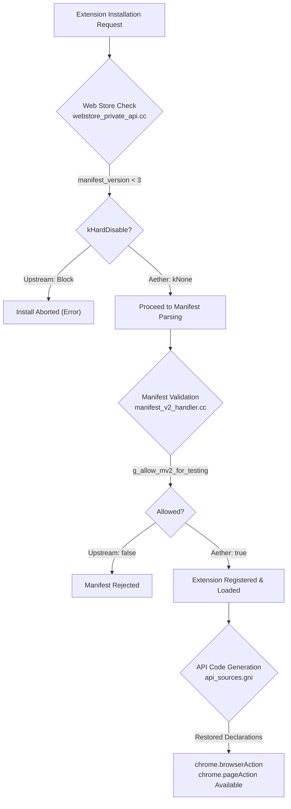

# Manifest V2 (MV2) Architecture & Security Review (`docs/MV2.md`)

> **Document:** `docs/MV2.md`  
> **Status:** Active / Production  
> **Phase:** Phase 4 (Task `T-4.2`)  
> **Feature ID:** `FEAT-05`  
> **Security Gate:** `SECURITY-REVIEW`  
> **Associated Patch:** [`patches/aether/extensions/0008-mv2-support-and-deprecation-bypass.patch`](../patches/aether/extensions/0008-mv2-support-and-deprecation-bypass.patch)  

---

## 1. Executive Summary & Problem Statement

Google upstream Chromium is systematically deprecating and removing support for **Manifest V2 (MV2)** extensions in favor of Manifest V3 (MV3). Concurrently, Google's experimental "desktop Android" extension subsystem is architected to be strictly MV3-only.

However, the primary ad-blocking engine chosen for Aether Browser — **uBlock Origin** (`gorhill/uBlock`) — fundamentally depends on Manifest V2 APIs:
- `chrome.webRequest` and `webRequestBlocking`: Synchronous network request interception and cancellation prior to socket dispatch.
- Dynamic filtering, CNAME uncloaking, and strict regex filter rules: Features impossible to execute fully within the rule-budget limitations of MV3's `declarativeNetRequest`.
- Persistent or event-driven background scripts: Required for real-time filter list compilation and logger inspector streaming.

To deliver an uncompromised desktop Helium browsing experience on mobile, **Aether Browser explicitly un-guards and re-enables Manifest V2 on Android**.

---

## 2. Upstream Guards Bypassed

Chromium upstream enforces MV2 deprecation at three distinct layers:

### 2.1 API Declarations (`chrome/common/extensions/api/api_sources.gni`)
- **Guard:** Upstream removed `"browser_action.json"` and `"page_action.json"` from default extension API compilation targets on newer builds.
- **Bypass:** Re-added `"browser_action.json"` and `"page_action.json"` to `uncompiled_sources_`.
- **Effect:** Generates necessary C++ bindings and JavaScript IDL stubs for legacy MV2 action APIs (`chrome.browserAction.setPopup`, `chrome.browserAction.setIcon`, `chrome.browserAction.setBadgeText`).

### 2.2 Webstore Installation Gate (`extensions/browser/api/webstore_private/webstore_private_api.cc`)
- **Guard:** `WebstorePrivateBeginInstallWithManifest3Function` checks `manifest_version < 3` and returns `api::webstore_private::MV2DeprecationStatus::kHardDisable`.
- **Bypass:** Replaced `kHardDisable` with `api::webstore_private::MV2DeprecationStatus::kNone`.
- **Effect:** The Chrome Web Store installer API permits downloading and staging MV2 CRX packages without throwing deprecation exceptions.

### 2.3 Manifest V2 Handler (`extensions/browser/manifest_v2_handler.cc`)
- **Guard:** `g_allow_mv2_for_testing` default was `false`. When false, MV2 extensions are blocked at manifest parse time or marked disabled with policy warnings.
- **Bypass:** Initialized `g_allow_mv2_for_testing = true`.
- **Effect:** Un-guards the entire manifest parsing pipeline for `manifest_version: 2`, allowing persistent background pages, content scripts, and web request filters.

---

## 3. Security Review & Threat Assessment (`SECURITY-REVIEW`)

| Threat Vector | Risk Level | Upstream Argument for MV3 | Aether Mitigation in MV2 |
|---|---|---|---|
| **Arbitrary Code Execution in Background** | Medium | MV3 eliminates arbitrary remote code execution by disallowing `eval()` and remote scripts. | Aether preserves CSP protections and does not allow remote code injection. All extension code must originate locally within the installed `.crx` or package. |
| **Silent Web Traffic Interception** | High | `webRequestBlocking` allows extensions to inspect request URLs, headers, and payloads. | 1. Android runtime requires explicit user confirmation before installing any extension. 2. Network requests to CWS / update servers are anonymized (`0006-anonymize-cws-extension-requests.patch`). 3. Off-store installs require explicit user approval via SAF or local file picker. 4. All extensions run inside Vanadium-hardened isolated renderer sandboxes. |
| **Background Battery & Memory Drain** | Medium | Persistent background pages consume RAM indefinitely. | Process priority is managed via `ChildProcessImportance.IMPORTANT` during active browsing, but child process memory is subject to OS memory budgets and tab discard policies. |

---

## 4. Upstream Rebase & Maintenance Plan (Risk `R-01`)

Upstream Chromium will eventually remove the C++ `webRequestBlocking` implementation files entirely from `extensions/browser/api/web_request/`.

### Mitigation Strategy:
1. **Isolated Patch Strategy:** All MV2 modifications are confined to `patches/aether/extensions/0008-mv2-support-and-deprecation-bypass.patch`. No MV2 logic is entangled with core browser UI or network code.
2. **Rebase CI Linter:** The GitHub Actions workflow tests patch application against upstream tags. If `0008-mv2-support-and-deprecation-bypass.patch` fails to apply, the build fails immediately with a designated notification.
3. **Graceful Fallback Path:** If upstream removes internal `webRequestBlocking` infrastructure beyond sustainable maintenance, Aether will seamlessly pivot to **uBlock Origin Lite (MV3)** as the default built-in blocker without regressing core browser stability.
