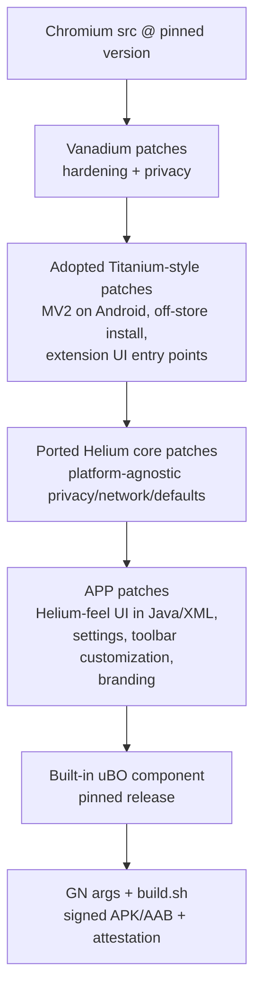

# PROJECT BRIEF — Porting the Helium Browser Experience to Android

> **Document type:** Engineering brief and execution plan for an AI coding agent working with a human maintainer.
> **Document version:** 1.0 (2026-11-02)
> **Product codename:** `{{APP_NAME}}` (placeholder; MUST NOT be "Helium", see §2.4)
> **Android package id:** `{{PACKAGE_ID}}` (e.g. `io.github.{{owner}}.{{app}}`)

---

## 0. HOW TO USE THIS DOCUMENT (read first, AI agent)

You are an AI coding agent. A human maintainer works with you, owns the build machine, and approves every merge.

**Reading order:** §1 → §2 (rules, mandatory) → §3 (context) → §4–§6 (architecture, stack, features) → the current phase in §7 → the relevant deep dives (§8–§12).

**Identifiers.** Every item has a stable ID; always refer to items by ID in your outputs:
- `PH-n` = phase
- `T-n.m` = task m of phase n
- `FEAT-xx` = feature in the feature matrix (§6)
- `R-xx` = risk (§13)
- `ADR-xx` = architecture decision record (you will create these)

**Unit of work.** Work on exactly ONE task card (`T-n.m`) at a time. For each, produce:
1. A short plan: the files you expect to touch, found by searching, not guessed.
2. The change, as one or more patch files (format in §2.2).
3. Verification evidence: build command plus result, and a test or manual check.
4. An update to `docs/PATCH_LEDGER.yaml` and/or `docs/STATUS.md`.

**When uncertain:** state the uncertainty explicitly, list the options, and ask the maintainer. Never fill gaps with invented APIs, flags, file paths or GN args.

---

## 1. MISSION AND SCOPE

### 1.1 Mission
Ship an Android browser built on Chromium that reproduces the **feel** of Helium on desktop: de-Googled, zero-noise, minimal, privacy-by-default, and user-customizable. It must also have **first-class extension support** and **uBlock Origin (full, MV2) built in**.

### 1.2 Priorities
| Priority | Meaning | Items |
|---|---|---|
| **P0 (must ship)** | Release blocker | Extension support (Chrome Web Store + local CRX), built-in full uBlock Origin, de-Googling/privacy core, Helium-style minimal UI and customization, reproducible signed builds, monthly Chromium updates |
| **P1 (should ship)** | Expected soon after v1 | Onboarding flow, fingerprinting-noise settings, tab hibernation option, copy-URL actions, zoom presets |
| **P2 (optional)** | Explicitly optional now | Native !bangs, split view on tablets/foldables, auto-hide ("zen-like") toolbar |
| **Out of scope** | Do not work on | Vertical tabs, iOS, sync, Android System WebView replacement, DRM/Widevine |

### 1.3 Definition of "Helium feel" (design principles)
1. **Zero noise.** No promos, no Google upsells, no AI-feature entry points, no "sign in to Chrome", no Discover/feed.
2. **Zero surprise network requests.** The browser makes no requests the user did not cause, except clearly-labelled, user-toggleable updates (filter lists, extension updates).
3. **Minimal chrome.** A compact toolbar, a trimmed overflow menu and context menus, a clean new tab page.
4. **User control.** The user chooses which toolbar buttons appear, the theme and accent colour, the search engine, and privacy toggles. Settings are discoverable, flat, and honest.
5. **Batteries included, not bloat.** uBO is preinstalled and works out of the box; there are no other bundled extras.

---

## 2. HARD RULES FOR THE AI AGENT (MANDATORY)

### 2.1 Correctness rules
- **R-NO-INVENT:** Do NOT invent Chromium class names, methods, GN args, build flags, feature names, prefs, or file paths. Before using any of them, locate it in the checked-out source with `rg` (ripgrep) or `gn args --list`, and quote the file path and line where you found it.
- **R-VERSION:** Chromium APIs change every release. Your training data is probably stale. The checked-out source tree at the pinned version (see `versions.lock`) is the only source of truth.
- **R-COMPILE:** No change is "done" until it compiles with the project's real build command and the relevant check passes. If you cannot run builds, say so and mark the task `UNVERIFIED`.
- **R-SMALL:** Keep each patch focused on one feature and as small as possible. Prefer feature flags, prefs, and resource overrides over invasive rewrites, because smaller diffs rebase more easily every month.
- **R-NO-SUBMODULE-EDITS:** Never edit upstream submodules (Vanadium, Chromium) in place. All changes are patch files in this repo, applied by `patch.sh`.
- **R-SECURITY:** Any change touching networking, certificates, sandboxing, permissions, extension install/verification, or IPC must be flagged `SECURITY-REVIEW` for mandatory human line-by-line review.
- **R-PRIVACY:** Never add a network endpoint, analytics, crash upload, or remote config. Any new outbound request must be listed in `docs/NETWORK_ENDPOINTS.md` with a justification and a user toggle.

### 2.2 Output format rules
- Patches are unified diffs in `git format-patch` style, with paths relative to Chromium `src/`.
- Patch file naming: `patches/{{app}}/<area>/<short-kebab-name>.patch`. Areas: `core`, `privacy`, `extensions`, `ublock`, `ui`, `settings`, `branding`, `build`.
- Every patch header contains: `Subject:`, a 1–3 sentence description, `Feature: FEAT-xx`, and `Origin: original | adapted-from:<url-or-patch-name>`.
- Add every new patch to `patches/series` in correct dependency order.
- Status reports use this template:

```
TASK: T-n.m — <title>
STATE: DONE | PARTIAL | BLOCKED | UNVERIFIED
FILES: <list of patch files and touched src paths>
EVIDENCE: <build command + result; test names or manual check>
RISKS/NOTES: <anything the maintainer must know>
NEXT: <proposed next task>
```

### 2.3 Communication rules
- Be explicit about assumptions. Prefix them with `ASSUMPTION:`.
- If two approaches exist, give a 2–4 line comparison and a recommendation, then wait for approval when the choice is architectural (record it as an ADR).

### 2.4 Legal and branding rules
- The product MUST NOT use the name, logo, or icon of "Helium" or "Titanium". Use `{{APP_NAME}}`.
- Before copying any patch from an upstream project, record its license in `docs/LICENSES.md` and confirm compatibility (see T-0.4). If compatibility is unclear, STOP and ask.
- Preserve upstream copyright headers and credit sources in the patch `Origin:` field.

---

## 3. BACKGROUND CONTEXT (facts the agent needs)

> These facts were gathered in November 2026 and may be outdated. Verify version-specific details against the actual repositories.

### 3.1 Helium (desktop): what we are emulating
- **What it is:** A privacy-focused Chromium browser by imput (`imputnet` on GitHub). It is desktop only (Windows, macOS, Linux) and has no official mobile app.
- **Layered architecture:**
  1. Chromium core
  2. ungoogled-chromium (removes Google integrations and dependencies)
  3. A patch series grouped by origin: upstream backports, Inox, Iridium, ungoogled-chromium, Bromite (fingerprinting), Brave (import), and a large set of Helium-specific patches for features and UI
  4. Helium Services (privacy-respecting backend: proxied extension and filter-list updates, onboarding assets)
- **Repositories:**
  - Main patch/source repo: `imputnet/helium`, referred to in changelogs as `helium-chromium`.
  - Platform repos: `helium-linux`, `helium-macos`, `helium-windows`.
  - uBO fork: `imputnet/uBlock`.
- **Patch mechanics:** Patches are applied in the order listed in `patches/series`, using ungoogled-chromium-style tooling (`utils/patches.py`). Helium also uses name substitution (`utils/name_substitution.py`), domain substitution, and resource and version patches.
- **uBlock Origin integration:** uBO ships as a **component extension** downloaded at build time into `third_party/ublock`. It is preconfigured, its filter updates are proxied through Helium Services, and it is surfaced in Settings.
- **Opinionated defaults:** Helium has a "Helium Opinionated Policies (HOP)" system and privacy-first default prefs (for example, search suggestions are off by default, GPC is exposed only when relevant, and non-standard auth features are off).
- **Notable user-facing features (desktop):**
  - Privacy: no Google endpoints, anonymized Chrome Web Store requests, extended MV2 support, fingerprinting-noise settings, WebRTC IP policy.
  - Built in: uBO, native !bangs.
  - UI: compact layout, customizable toolbar (hide elements), rounded frame, simplified context menu, trimmed settings (removes "AI Innovations" and "Safety Hub"), split view, vertical tabs, "zen" mode (auto-hide chrome).
  - Behaviour: hibernate other tabs, copy URL(s) from the tab context menu, extra zoom presets, theme colour palettes, onboarding.
  - In development: sync.

### 3.2 Why Helium cannot be "recompiled for Android"
- Desktop Chromium UI = C++ **Views** (`chrome/browser/ui/views/...`). Android Chromium UI = **Java** (`chrome/android/java/...`, `chrome/browser/*/android/...`) plus Android XML resources.
- So most of Helium's UI patches **do not apply** to Android. They must be **re-designed** in Java and XML. Helium's core privacy and network patches are often platform-agnostic C++ and **may apply** with adaptation.
- Helium patches are written against **desktop** build configurations. Code guarded by desktop-only build flags is not compiled on Android.

### 3.3 Extensions on Android (upstream state)
- Upstream Chromium is gradually porting extensions to an experimental **"desktop Android"** build configuration using build flags. The flags documented upstream (`extensions/docs/buildflags.md`) are:
  - `ENABLE_EXTENSIONS`: now means Win/Mac/Linux/ChromeOS only, not desktop Android.
  - `ENABLE_EXTENSIONS_CORE`: extension code for all platforms, including desktop Android.
  - `ENABLE_DESKTOP_ANDROID_EXTENSIONS`: code that only runs on the desktop Android build.
  - `IS_ANDROID`: platform differences; also occasionally used to exclude MV2-only code.
- **Critical:** upstream desktop Android supports **Manifest V3 only**. Full uBlock Origin is MV2. We MUST carry patches that re-enable MV2 on Android (see §9).
- Code still behind `ENABLE_EXTENSIONS` (not `_CORE`) is not compiled for Android. Some features we need may live there and require porting or patching.

### 3.4 Prior art (study before writing code)
| Project | What it is | What to learn from it |
|---|---|---|
| **Titanium Browser for Android** (`jqssun/android-titanium-browser`, GPL-2.0; formerly "Helium Browser for Android") | Chromium on Android with extension support, built on Vanadium. Not affiliated with desktop Helium. | **Primary reference for P0 extensions and uBO.** Its patch groups are Feature Overrides, UI Overrides, "Manifest V2 + Secure Off Store Install Support", and Miscellaneous Fixes. Repo layout: `vanadium` submodule, `.gclient`, `args.gn`, `build.sh`, `common.sh`, `patch.sh`, `res/`, `extensions/`. It builds and signs on GitHub Actions with build attestation. Extensions install from the Chrome Web Store (via "desktop site"), Opera and Edge add-on stores, local CRX/ZIP, and unpacked via `chrome://extensions` with a SAF picker. Advanced features are split into a companion "Titanium Extension for Android". |
| **Vanadium** (`GrapheneOS/Vanadium`) | Hardened, privacy-focused Chromium for Android | Hardening and privacy patch set (`patches/*.patch`, `subprojects_patches/**`). This is the recommended base layer. |
| **ungoogled-chromium** | De-Googling patches and tooling | Patch tooling, domain substitution, pruning concepts |
| **Bromite / Cromite** | Historic and current Android Chromium forks | Android-specific adblock, fingerprinting, and UI patches (study only; check licenses) |
| **Kiwi Browser** | Former Android Chromium with extensions (discontinued) | Cautionary tale: forks die when they cannot keep up with rebases |

### 3.5 Platform constraint
- **iOS is out of scope.** Apple requires WebKit outside narrow regional exceptions, so a Chromium/Blink port is not possible there.

---

## 4. TARGET ARCHITECTURE

### 4.1 Layer model


### 4.2 Base decision (to be confirmed in ADR-01)
- **Option A (recommended):** Mirror Titanium's build structure, with Vanadium as a submodule plus our own patch layers. Adopt (with credit and license compliance) or re-implement Titanium's MV2 and extension patches, then add Helium-feel layers on top.
  - **Pro:** Fastest path to working P0 extensions.
  - **Con:** Depends on the Titanium and Vanadium cadence; GPL-2.0 obligations.
- **Option B:** Vanadium plus fully original extension and MV2 work.
  - **Pro:** Full control.
  - **Con:** Months of extra work on the hardest part.
- **Option C:** Contribute upstream to Titanium instead of forking.
  - **Pro:** Least maintenance.
  - **Con:** Less control over the "Helium feel".

### 4.3 Repository layout (target)
```
{{app}}-android/
├── .github/workflows/        # build.yml, rebase-bot.yml, release.yml
├── vanadium/                 # git submodule (pinned commit)
├── patches/
│   ├── series                # ordered list of ALL our patches
│   └── {{app}}/{core,privacy,extensions,ublock,ui,settings,branding,build}/
├── res/                      # icons, branding drawables, strings overrides
├── components/ublock/        # pinned uBO release metadata (version, URL, sha256)
├── docs/
│   ├── ADR/                  # ADR-01..n
│   ├── PATCH_LEDGER.yaml     # triage of every Helium/upstream patch (§8)
│   ├── FEATURE_MATRIX.md     # living copy of §6
│   ├── NETWORK_ENDPOINTS.md
│   ├── LICENSES.md
│   └── STATUS.md
├── .gclient
├── args.gn                   # release GN args
├── args.debug.gn             # dev GN args
├── versions.lock             # chromium version, vanadium commit, uBO version
├── common.sh  patch.sh  build.sh  sign.sh
└── README.md
```

---

## 5. TECH STACK

| Layer | Technology | Notes for the agent |
|---|---|---|
| Engine | Chromium (Blink, V8) at the version Vanadium's current tag targets | Pin it in `versions.lock`. Never mix versions. |
| Native code | C++ (Chromium style) | Follow the Chromium style guide. Use `base::Feature` for toggles. |
| Android UI | Java (primary), Android XML resources | Chromium Android UI is mostly Java. Use Kotlin only where the surrounding code already uses it. |
| Build system | `depot_tools` (`gclient`, `gn`, `autoninja`), Python 3 | `autoninja` dispatches to the build backend for that Chromium version (Ninja or Siso). Do not assume which. |
| Patch tooling | Plain `git apply` / `patch` driven by `patches/series` (as in Titanium), optionally ungoogled-chromium `utils/patches.py` | Patches must apply with zero fuzz in CI. |
| Extensions | Chromium extensions system (`//extensions`, `//chrome/browser/extensions`) with MV2 re-enabled | See §9. |
| Ad blocking | uBlock Origin (gorhill upstream, or imput's fork if license and permission allow), bundled as a component extension | See §10. |
| CI/CD | GitHub Actions; large or self-hosted runner recommended | Release builds are signed with secrets; publish build attestations. |
| Signing | `apksigner`, keystore in CI secrets | Keep the keystore offline and backed up. Losing it breaks updates. |
| Distribution | GitHub Releases (+ Obtainium), optionally Google Play | Play requires an AAB and policy compliance. |
| Dev tools | `rg`, `git`, `adb`, Android emulator (x86_64), physical arm64 devices, `source.chromium.org` | Primary target ABI is `arm64-v8a`. |
| Testing | Chromium JUnit/Robolectric and instrumentation tests where they exist, custom smoke scripts, manual QA checklist | See §11. |

**Build host minimums (plan for these):** Ubuntu LTS x86-64, 32 GB+ RAM (64 GB preferred), 300 GB+ free SSD, fast network for the initial sync. Standard hosted CI runners are tight on disk, so prefer large or self-hosted runners.

---

## 6. FEATURE MATRIX (Helium desktop → Android)

**Strategy legend:**
- `PORT`: apply or adapt an existing patch.
- `ADOPT`: take from Titanium or Vanadium.
- `REIMPL`: new Android implementation.
- `DEFER`: optional or later.
- `DROP`: not applicable.

| ID | Feature | Priority | Strategy | Notes |
|---|---|---|---|---|
| FEAT-01 | Remove Google services, promos, sign-in, feed/Discover, AI entry points | P0 | ADOPT (Vanadium) + REIMPL | Audit the remaining Android entry points (menus, NTP, settings). |
| FEAT-02 | Zero unsolicited network requests | P0 | PORT + ADOPT | Verify with a traffic capture (§11). |
| FEAT-03 | Privacy-first default prefs (HOP equivalent) | P0 | PORT | Map Helium's defaults to Android prefs; use managed-policy defaults where possible. |
| FEAT-04 | Extension runtime on Android | P0 | ADOPT | Base it on Titanium's approach. |
| FEAT-05 | MV2 support on Android | P0 | ADOPT | Required for full uBO. Long-term risk R-01. |
| FEAT-06 | Install from the Chrome Web Store without the "desktop site" toggle | P0 | REIMPL | Make the CWS "Add" button work on mobile. Helium desktop also fixes CWS button detection. |
| FEAT-07 | Install from local CRX/ZIP; load unpacked via SAF | P0 | ADOPT | |
| FEAT-08 | Extension UI entry points (action/popup, options pages, manage page) | P0 | ADOPT + REIMPL | An Android-native "Extensions" menu and an optional toolbar button. |
| FEAT-09 | Built-in uBO as a component extension | P0 | REIMPL (model on Helium desktop) | Preinstalled, updatable, cannot be silently removed, can be disabled. |
| FEAT-10 | uBO quick toggle on the toolbar or in the menu | P0 | REIMPL | One tap to open the popup or toggle for the current site. |
| FEAT-11 | Anonymized CWS / extension update requests | P0 | PORT | Strip identifying parameters. |
| FEAT-12 | Compact toolbar layout | P0 | REIMPL | Reduced height, fewer default buttons. |
| FEAT-13 | Customizable toolbar (choose visible buttons) | P0 | REIMPL | Home, share, tab switcher, extensions, uBO, new tab, bookmarks. |
| FEAT-14 | Trimmed overflow menu | P0 | REIMPL | Remove Google and noise items; let users reorder or hide items (P1). |
| FEAT-15 | Simplified context menus (links, images, text) | P0 | PORT idea + REIMPL | Remove Google Lens/search promos. |
| FEAT-16 | Clean new tab page (no feed; optional shortcuts) | P0 | REIMPL | Respect "show most visited" toggle. |
| FEAT-17 | Themes: light/dark/system plus accent colour palettes | P0 | REIMPL | Use Material You dynamic colour as one option. |
| FEAT-18 | Flat, honest settings with a "{{APP_NAME}} services" page | P0 | REIMPL | List every network-using feature with toggles. |
| FEAT-19 | Search engines: privacy-respecting defaults, suggestions off by default | P0 | PORT | |
| FEAT-20 | WebRTC IP handling policy setting | P0 | ADOPT | Titanium exposes this in Privacy settings. |
| FEAT-21 | Global Privacy Control toggle | P1 | PORT | |
| FEAT-22 | Fingerprinting-noise settings | P1 | PORT/ADOPT | Reconcile Helium's noise patches with Vanadium's. |
| FEAT-23 | Hibernate (discard) other tabs | P1 | REIMPL | Use Android tab discarding. |
| FEAT-24 | Copy URL(s) from the tab switcher | P1 | REIMPL | |
| FEAT-25 | Extra zoom presets / default zoom | P1 | REIMPL | Android has accessibility text scaling; integrate with it. |
| FEAT-26 | Onboarding / first-run (choose search engine, theme, uBO lists) | P1 | REIMPL | Fully local, no network. |
| FEAT-27 | Bookmark/settings import | P2 | DEFER | |
| FEAT-28 | Native !bangs | P2 | DEFER | Optional per the maintainer. Offline bang list in the omnibox. |
| FEAT-29 | Split view (tablets/foldables only) | P2 | DEFER | Use Android multi-window or the upstream tablet split feature, if present. |
| FEAT-30 | Auto-hide chrome ("zen-like") | P2 | DEFER | |
| FEAT-31 | Vertical tabs | — | DROP | Per the maintainer. |
| FEAT-32 | Sync | — | DROP (for now) | Helium sync is still in development upstream. |

---

## 7. DEVELOPMENT PHASES

Each phase lists: **Goal**, **Tasks**, **Deliverables**, **Exit criteria** (all must be true). Do not start a phase until the previous phase's exit criteria are met, unless the maintainer explicitly allows parallel work.

### PH-0 — Discovery, decisions, legal gate
**Goal:** Understand all upstreams and make the base decision.

**Tasks:**
- T-0.1 Clone and read Titanium: README, `build.sh`, `patch.sh`, `common.sh`, `args.gn`, the workflow file, and every patch. Write `docs/research/titanium.md`, summarizing each patch in 1–2 lines grouped by category.
- T-0.2 Read Vanadium's patch list and write `docs/research/vanadium.md`, covering the categories and which privacy features it already provides.
- T-0.3 Read Helium's `patches/series` and group names. Write `docs/research/helium.md` (inventory only; triage happens in PH-2).
- T-0.4 **Legal gate:** record the license of Chromium, Vanadium, Titanium, Helium, ungoogled-chromium, uBO, and any other donor in `docs/LICENSES.md`, then state compatibility conclusions. Flag any GPL-2.0-only vs GPL-3.0 conflicts.
- T-0.5 Write ADR-01 (base option A/B/C, §4.2), ADR-02 (name, package id, icon), and ADR-03 (filter-list and extension-update network path: direct, self-hosted proxy, or partner).

**Deliverables:** `docs/research/*`, `docs/LICENSES.md`, ADR-01..03.

**Exit criteria:** The maintainer has approved all three ADRs, and no license blocker remains open.

### PH-1 — Reproducible build infrastructure
**Goal:** Build the unmodified base (Vanadium, or Titanium per ADR-01) under our own name and signing key.

**Tasks:**
- T-1.1 Create the repo skeleton (§4.3) and `versions.lock`.
- T-1.2 Write `common.sh`, `patch.sh`, and `build.sh`, modelled on Titanium's. Steps: sync (`gclient sync` at the pinned version), apply the upstream patch sets, apply `patches/series`, `gn gen` with `args.gn`, build with `autoninja`, then sign.
- T-1.3 Determine the correct APK/AAB build target and GN args by reading the base project's scripts and `gn args --list`, not from memory. Document them in `docs/BUILD.md`.
- T-1.4 Add a branding patch (`patches/{{app}}/branding/`) for the app name, package id, and icons.
- T-1.5 Set up a CI workflow with a manual trigger, runner choice, and caching of the checkout where feasible, plus signing from secrets and build attestation.
- T-1.6 Add a dev loop doc: incremental builds, `adb install`, and running on an emulator and a physical device.

**Deliverables:** A signed APK from CI with our branding; `docs/BUILD.md`.

**Exit criteria:** A clean CI build succeeds twice in a row from scratch. The APK installs next to Chrome, browses, and shows our name in About.

### PH-2 — Patch triage ledger
**Goal:** Classify every Helium patch (and the relevant ungoogled/Bromite ones) for Android applicability.

**Tasks:**
- T-2.1 For each patch in Helium's `patches/series`, add an entry to `docs/PATCH_LEDGER.yaml` (schema in §8).
- T-2.2 For each entry, determine: touched paths; whether those paths compile on Android (check `BUILD.gn` conditions and build flags); whether Vanadium or Titanium already covers it; the strategy (PORT/ADOPT/REIMPL/DROP); the mapped FEAT ID; and an effort estimate (S/M/L).
- T-2.3 Produce a summary table: counts per strategy and the top 15 high-value PORT candidates.

**Deliverables:** `docs/PATCH_LEDGER.yaml` and `docs/PATCH_TRIAGE_SUMMARY.md`.

**Exit criteria:** 100% of patches have been triaged, and the maintainer has reviewed all DROP and REIMPL decisions.

### PH-3 — Privacy and de-Googling core
**Goal:** Deliver FEAT-01, 02, 03, 11, 19, and 20.

**Tasks:**
- T-3.1 Port high-value platform-agnostic Helium patches from the ledger, one patch per task card.
- T-3.2 Audit the Android-only Google entry points that remain (NTP feed, sign-in promos, Lens, translate promos, AI entry points, "Chrome tips", and so on). Remove or disable each with the smallest possible patch.
- T-3.3 Implement privacy default prefs (HOP equivalent) in one patch. Document every changed default in `docs/DEFAULTS.md`.
- T-3.4 Network audit: launch fresh, idle for 10 minutes, open settings, and visit `about:blank`. Capture all traffic. Every request must be listed in `docs/NETWORK_ENDPOINTS.md` with a toggle.

**Exit criteria:** The network audit shows zero unlisted requests, and the Chromium privacy test sites behave as expected.

### PH-4 — Extensions runtime and MV2 (P0 critical path)
**Goal:** Deliver FEAT-04, 05, 06, 07, and 08.

**Tasks:**
- T-4.1 Bring in the extension runtime enablement, following Titanium's approach and ADR-01. Document every GN arg and patch involved.
- T-4.2 Re-enable MV2 on Android. Identify every MV2 guard (`IS_ANDROID`, MV2 deprecation features, and experiment flags) in the pinned source and document them in `docs/MV2.md`. Mark the patch `SECURITY-REVIEW`.
- T-4.3 Make Chrome Web Store installs work in mobile mode: fix "Add to Chrome" button detection and avoid needing the desktop-site toggle.
- T-4.4 Add off-store install (CRX/ZIP) with verification and clear permission prompts. Mark `SECURITY-REVIEW`.
- T-4.5 Build the Android-native extension UI: a manage page, a menu entry, toolbar actions, and popups shown in a bottom sheet or dialog that fits phone screens.
- T-4.6 Run the compatibility test matrix (§9.3).

**Exit criteria:** All extensions in the §9.3 matrix install, run, and survive an app restart. MV2 uBO from the CWS works fully, including the element picker and the dashboard.

### PH-5 — Built-in uBlock Origin
**Goal:** Deliver FEAT-09 and FEAT-10 (details in §10).

**Exit criteria:**
- uBO is active on first launch with no user action and blocks ads on the test pages.
- Filter-list updates follow the path chosen in ADR-03 and can be disabled.
- The user can open the uBO popup in one tap.

### PH-6 — Helium-feel UI and customization
**Goal:** Deliver FEAT-12 to FEAT-18 (P0), then FEAT-23 to FEAT-26 (P1).

**Tasks:**
- T-6.1 Design spec: for each FEAT, write a short spec in `docs/ui/FEAT-xx.md` covering the user story, screens, prefs keys, defaults, and the affected Java classes (found by search). The maintainer approves each spec before implementation.
- T-6.2 Toolbar: compact height and a customization screen (a list of buttons with toggles and order), stored in prefs.
- T-6.3 Overflow menu and context menus: remove noise items and add our items (Extensions, uBO, Copy URL).
- T-6.4 New tab page: a minimal NTP with optional shortcuts and no feed.
- T-6.5 Theming: light, dark, system, accent palettes, and an optional dynamic colour.
- T-6.6 Settings restructure: a flat hierarchy with a "{{APP_NAME}} services" page listing every network feature.
- T-6.7 P1 features (FEAT-23 to FEAT-26), one task card each.

**Exit criteria:** The UI QA checklist (§11.3) passes on a small phone (≤ 6"), a large phone, and a tablet, in both light and dark mode.

### PH-7 — Hardening, performance, QA
**Tasks:**
- T-7.1 Review every `SECURITY-REVIEW` patch with the maintainer and record sign-off.
- T-7.2 Performance: cold start time, RAM with 0, 3, and 10 extensions, and battery over a 30-minute browse, compared against the base build.
- T-7.3 Privacy leak tests: DNS, WebRTC, referrer, and fingerprinting test sites.
- T-7.4 Crash triage, done locally only with no crash upload.

**Exit criteria:** No open P0 bugs. Performance stays within agreed budgets (default: no more than 15% worse than the base build with uBO enabled).

### PH-8 — Release and maintenance automation
**Tasks:**
- T-8.1 Release pipeline: versioning scheme (`<chromium_major>.<app_rev>`), changelog generation, signed release, and attestation.
- T-8.2 Rebase bot workflow (§12): on each new Vanadium tag, attempt to apply patches, report failures, propose fixes as a PR.
- T-8.3 Security response policy: target time from an upstream security release to our release (default ≤ 7 days).
- T-8.4 Optionally prepare Play Store metadata (fastlane) and do a policy review.

**Exit criteria:** One full upstream version bump has been completed through the pipeline.

### PH-9 — Optional features (P2)
- FEAT-28 bangs, FEAT-29 split view (tablet), FEAT-30 auto-hide chrome. Each needs its own spec and maintainer approval.

---

## 8. PATCH LEDGER SCHEMA (`docs/PATCH_LEDGER.yaml`)

```yaml
- id: HL-0001                      # stable ledger id
  source: helium                   # helium | ungoogled | bromite | vanadium | titanium | own
  upstream_path: patches/helium/core/example.patch
  summary: "One line: what it does."
  touched_paths:
    - chrome/browser/ui/views/...
  compiles_on_android: no          # yes | no | partial (with reason)
  android_reason: "Views UI is desktop-only"
  covered_by_base: none            # none | vanadium | titanium (+ which patch)
  strategy: REIMPL                 # PORT | ADOPT | REIMPL | DROP | DEFER
  feature: FEAT-13
  effort: M                        # S | M | L
  security_review: false
  status: todo                     # todo | in_progress | done | dropped
  our_patch: patches/{{app}}/ui/toolbar-customization.patch
  notes: ""
```

**Triage heuristics:**
- Paths under `ui/views`, `chrome/browser/ui/views`, `chrome/browser/ui/webui/side_panel` → almost always **REIMPL** or **DROP**.
- Paths under `net/`, `services/network`, `components/*` (non-UI), `chrome/browser/*` (non-UI), and `third_party/blink` → **PORT** candidates.
- Pref and default changes → **PORT**, usually trivial.
- WebUI settings pages (`chrome/browser/resources/settings`) → Android does not use WebUI settings for most pages, so **REIMPL** in Java preferences.

---

## 9. EXTENSIONS DEEP DIVE

### 9.1 Requirements
1. Install from the Chrome Web Store (primary), Edge Add-ons, Opera Add-ons, and local CRX/ZIP, and load unpacked in developer mode.
2. Support both MV3 and **MV2**.
3. Extensions persist across restarts and updates; an incognito toggle is available per extension.
4. Each extension's browser action and popup is reachable in at most 2 taps.
5. Options pages open as full tabs or sheets.
6. Extension updates go through a privacy-preserving path (anonymized requests; ADR-03).

### 9.2 Known hard problems (address explicitly in `docs/MV2.md` and `docs/EXTENSIONS.md`)
- **MV2 removal upstream:** Chromium keeps deleting MV2 code paths. Keep the MV2 patch isolated in its own file(s), add a CI check that fails loudly when the patch stops applying, and track R-01 every release.
- **Process model cost:** Every extension adds renderer/service-worker processes, which is heavy on low-RAM phones. Measure it (T-7.2) and consider lazy-loading extensions or limits on low-RAM devices.
- **Service worker lifecycle (MV3)** under Android's background process limits: test that background work survives app backgrounding and returning.
- **Desktop assumptions in extensions:** Popups sized for desktop, hover-dependent UIs, and keyboard shortcuts. Provide a responsive popup container.
- **Code still behind `ENABLE_EXTENSIONS` rather than `ENABLE_EXTENSIONS_CORE`:** list the needed APIs that are missing on Android, in the pinned source.

### 9.3 Compatibility test matrix (minimum)
| Extension | Manifest | Why |
|---|---|---|
| uBlock Origin (full) | MV2 | P0 core |
| uBlock Origin Lite | MV3 | MV3 declarativeNetRequest path |
| Bitwarden | MV3 | Popup, storage, autofill content scripts |
| Dark Reader | MV2 or MV3 | Content scripts on every page; performance |
| SponsorBlock | MV3 | Site-specific content scripts |
| Violentmonkey or Tampermonkey | MV2/MV3 | userScripts API |
| A translation extension | MV3 | Context menus, popups |

---

## 10. BUILT-IN UBLOCK ORIGIN DEEP DIVE

1. **Source:** Default to upstream gorhill uBO releases. Use imput's fork only if license and permission allow it (record the decision in ADR-04). Pin the version, URL, and sha256 in `components/ublock/`.
2. **Packaging:** Bundle uBO as a component extension at build time, modelled on Helium desktop (`third_party/ublock`). Find how component extensions are registered on Android in the pinned source; do not assume.
3. **Behaviour:** Enabled on first run with no prompts. The user can disable it but not silently lose it; reinstall-to-default is available.
4. **Updates:** Filter lists update on the schedule and network path from ADR-03, with a toggle in "{{APP_NAME}} services". The uBO code itself updates only with app releases.
5. **UI:**
   - A toolbar button (default on, configurable).
   - Long-press for per-site disable.
   - An "Ad blocking" entry in the overflow menu.
   - A settings link to the uBO dashboard.
6. **Tests:** An ad-blocking test page, the element picker on touch, dashboard settings persistence, and cosmetic filters on major sites.

---

## 11. TESTING AND QA

### 11.1 Automated (where feasible)
- Patch apply check: all patches apply with zero fuzz (CI, every commit).
- Build check: a release build in CI.
- Existing Chromium unit tests for touched components, where cheap to run.
- Smoke script via `adb`: install, launch, open URLs, confirm no crash in logcat.

### 11.2 Privacy verification
- Capture traffic on fresh install, idle, settings, and NTP. Compare it against `docs/NETWORK_ENDPOINTS.md`.
- Run WebRTC leak, DNS leak, and fingerprinting test sites. Record results per release in `docs/qa/`.

### 11.3 UI QA checklist (per release)
- [ ] No Google, AI, or sign-in promos anywhere: NTP, menus, settings, context menus, first run.
- [ ] Toolbar customization persists across restart.
- [ ] Light/dark/system and accent colours apply everywhere, including settings and extension sheets.
- [ ] uBO is reachable in ≤ 2 taps; extension popups are usable on a 6" screen.
- [ ] Layouts work on a small phone, a large phone, a tablet, and in landscape.
- [ ] Accessibility: TalkBack labels on new buttons; large font scale does not break layouts.

---

## 12. MAINTENANCE: THE MONTHLY REBASE LOOP

1. A new Vanadium tag (or Chromium stable) is detected, and the bot opens a tracking issue.
2. The bot updates `versions.lock`, syncs, and applies patches in `series` order.
3. For each failing patch, the AI agent:
   - reads the upstream diff for the conflicting files,
   - explains what changed upstream,
   - proposes an updated patch,
   - and labels it `REBASE-FIX` (plus `SECURITY-REVIEW` if applicable).
4. The CI build runs, followed by smoke tests and the extension matrix (§9.3) on an emulator.
5. A human reviews and merges, then the release goes out.

- **Target:** release within 7 days of an upstream security release.
- **Hard rule:** if the MV2 patch cannot be rebased within the window, ship the security update anyway with a clear notice, rather than holding security fixes hostage to MV2.

---

## 13. RISK REGISTER

| ID | Risk | Likelihood | Impact | Mitigation |
|---|---|---|---|---|
| R-01 | Upstream MV2 removal makes full uBO unmaintainable | High (over time) | Critical | Isolated MV2 patch; track upstream; fallback plan: uBO Lite (MV3) as default with a clear notice |
| R-02 | Desktop-Android extension code changes break the runtime each release | High | High | Extension matrix in CI; follow Titanium's fixes |
| R-03 | Falling behind on security releases | Medium | Critical | Rebase bot, 7-day SLA, small patches |
| R-04 | License incompatibility when reusing donor patches | Medium | High | Legal gate T-0.4; re-implement instead of copying when unclear |
| R-05 | Trademark or naming conflict | Medium | Medium | Original name and icon (ADR-02) |
| R-06 | Build cost or time exceeds CI limits | High | Medium | Self-hosted or large runner; checkout caching |
| R-07 | AI-introduced subtle bugs (invented APIs, wrong guards) | High | High | Rules §2.1; compile-verify loop; human review |
| R-08 | RAM and battery cost of extensions on low-end phones | Medium | Medium | Measure (T-7.2); low-RAM mode |
| R-09 | Play Store policy rejection | Medium | Low/Medium | GitHub/Obtainium as the primary channel |
| R-10 | Dependency on Helium Services for filter updates | Medium | Medium | ADR-03: direct or self-hosted path |

---

## 14. GLOSSARY

- **Component extension:** An extension bundled inside the browser build rather than installed from a store.
- **MV2/MV3:** Chrome extension Manifest versions 2 and 3. MV3 limits the blocking webRequest API that full uBO relies on.
- **Desktop Android:** Upstream Chromium's experimental Android configuration with extension support.
- **HOP:** Helium Opinionated Policies, Helium's set of privacy-first defaults.
- **Vanadium:** GrapheneOS's hardened Chromium for Android.
- **Titanium:** The community Android Chromium fork with extensions (formerly "Helium Browser for Android"); not affiliated with imput.
- **SAF:** Android Storage Access Framework, the file picker used for loading unpacked extensions.
- **ADR:** Architecture Decision Record.

---

## 15. REFERENCE LINKS

- Helium (desktop): https://helium.computer/ and https://github.com/imputnet/helium
- Helium platform repos: https://github.com/imputnet/helium-linux, `helium-macos`, `helium-windows`
- imput's uBO fork: https://github.com/imputnet/uBlock
- Titanium Browser for Android: https://github.com/jqssun/android-titanium-browser
- Titanium Extension for Android: https://github.com/jqssun/android-titanium-extension
- Vanadium: https://github.com/GrapheneOS/Vanadium
- ungoogled-chromium: https://github.com/ungoogled-software/ungoogled-chromium
- Chromium extension build flags: https://chromium.googlesource.com/chromium/src/+/main/extensions/docs/buildflags.md
- Chromium code search: https://source.chromium.org/chromium
- uBlock Origin: https://github.com/gorhill/uBlock

---

## APPENDIX A — TASK CARD TEMPLATE

```markdown
### T-n.m — <title>
Feature(s): FEAT-xx    Risk(s): R-xx    Security review: yes/no
Goal: <one sentence>
Context: <links to ledger entries, specs, ADRs>
Search first: <rg queries the agent must run before editing>
Steps:
  1. ...
Acceptance criteria:
  - [ ] Builds with build.sh (release args)
  - [ ] <functional check>
  - [ ] Ledger/STATUS updated
Out of scope: <explicit exclusions>
```

## APPENDIX B — STANDARD PROMPTS FOR THE AGENT

**B1. Patch triage (PH-2)**
> Given patch `<path>` and the Chromium source at the version in `versions.lock`: list touched files; for each, determine whether it is compiled for `target_os="android"` (cite the `BUILD.gn` condition or build flag); check whether Vanadium/Titanium already implements equivalent behaviour (cite their patch); then output ONE ledger YAML entry per §8. Do not guess. Mark unknown fields `UNKNOWN` with a reason.

**B2. Port a patch (PH-3)**
> Port ledger entry `<HL-id>` to Android. First run searches to locate the equivalent code paths and quote them. Produce the smallest patch possible, following §2.2. Build, report using the status template, and update the ledger.

**B3. Re-implement a UI feature (PH-6)**
> Implement `<FEAT-xx>` per `docs/ui/FEAT-xx.md`. Locate the existing Java classes and XML resources for the affected UI by search, and list them before editing. Use existing Chromium Android patterns (preferences framework, feature flags, theming). No new dependencies. Build, describe the manual test steps, and report.

**B4. Rebase fix (PH-8)**
> Patch `<name>` fails to apply on `<new version>`. Show the upstream commits that changed the conflicting hunks, explain the upstream intent, produce an updated patch that preserves our behaviour, and flag any semantic change for review.
